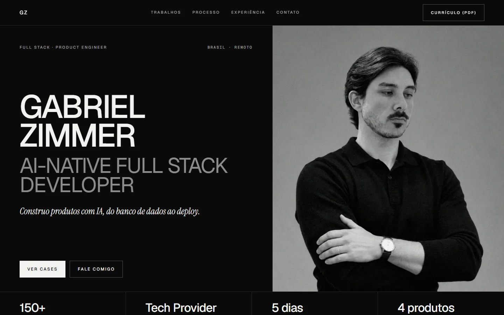
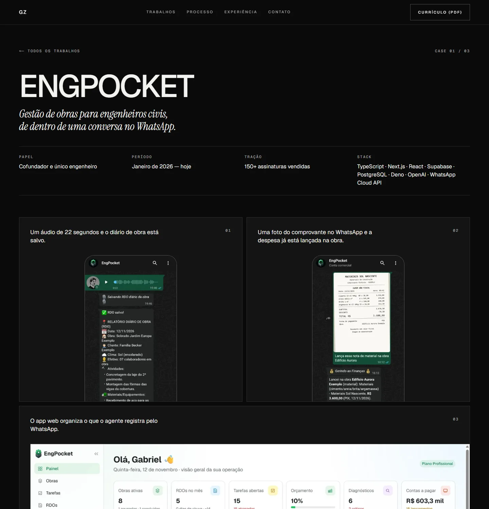

# Gabriel Zimmer · portfolio

[](https://github.com/devzimmer/portfolio-gabriel/actions/workflows/ci.yml)

Source of [dev.gabrielzimmer.com.br](https://dev.gabrielzimmer.com.br), the portfolio of an AI-native full stack developer: three case studies (EngPocket, Duzi CRM, Lumuviz), work history and how I build with AI coding agents. The site is in Portuguese for now.



## Stack

- **Next.js 16** (App Router, Cache Components with Partial Prerendering), **React 19**, **TypeScript**
- **Tailwind CSS 4**, next-intl, Lenis
- **Cloudflare Workers** through OpenNext, serving the prerendered pages from static assets, with Cloudflare Images
- **Vitest** and Testing Library, **Playwright**, GitHub Actions

## Worth a look

| Where | What |
| --- | --- |
| `src/components/ascii/` | The hands in the Process section: a pure, seeded engine (unit tested) and a small canvas component that draws it. A static frame replaces the animation under reduced motion. |
| `src/components/work/cases-rail.tsx` | Selected work pins under the header on large screens and scrolls sideways with the page. Tabbing to an off-screen case scrolls to it, trackpad swipes work, and phones or reduced motion get a plain list. |
| `src/components/motion/ink-text.tsx` | A statement that gains contrast word by word, done with CSS scroll-driven animations and no JavaScript. |
| `src/components/ui/protected-contact.tsx` | Email and phone never appear in the served HTML or RSC payload. The address is drawn by CSS until hydration, then becomes a normal link. |
| `next.config.ts` | Content-Security-Policy and security headers, with the reasoning for each trade-off. |
| `scripts/generate-images.mjs` | Favicon and Open Graph cards rendered from code with `next/og` and the site's own fonts. |
| `src/content/` | Case studies and experience as typed data. Tests enforce the content rules, such as which numbers may be cited and no placeholder text. |
| `src/lib/llms.ts` | `/llms.txt`, a plain-text profile for AI assistants, built from the same content as the pages. |

Every page is prerendered. Unknown URLs get a designed 404 page that is never indexed. The site has a skip link, a focus-trapped mobile menu, touch targets of at least 44 px and `prefers-reduced-motion` support throughout, and the e2e suite checks these.



## How it was built

With Claude Code, in the same spec-first loop described on the site. A written spec and plan come first. Changes are small and come with their tests, and CI runs lint, types, unit and e2e tests and a dependency audit on every push. I make the architecture and product calls, and AI agents write and review the code.

## Running it

Requires Node.js 22+ (see `.nvmrc`).

```bash
npm ci
npm run dev          # http://localhost:3000/pt
```

| Script | What it does |
| --- | --- |
| `npm test` | Unit tests (Vitest) |
| `npm run test:e2e` | End-to-end tests (Playwright; starts its own dev server) |
| `npm run check` | Lint and typecheck |
| `npm run build` | Production build |
| `npm run images` | Regenerates the favicon and share images |
| `npm run preview` | OpenNext build served in the Workers runtime |
| `npm run deploy` | OpenNext build and deploy to Cloudflare |

### Deploying

`npm run deploy` builds and ships the Worker. `wrangler.jsonc` binds the custom domain, and Cloudflare creates the DNS record and certificate on the first deploy. Nothing else needs provisioning: the prerendered pages ship with the static assets.

## Project layout

```text
messages/pt.json        UI strings
scripts/                Image generation
src/
  app/                  Routes, metadata, sitemap, robots, llms.txt, 404
  components/
    ascii/              Hands engine and canvas
    case/               Case study blocks
    layout/             Header, footer, mobile menu, skip link
    motion/             Smooth scroll, cursor label, scroll-driven text
    sections/           Home sections
    work/               Horizontal case gallery
    ui/                 Buttons, labels, protected contact links
  content/              Case studies and experience (typed, tested)
  lib/                  Site config, contact helpers, SEO, fonts
  proxy.ts              Locale routing and 404 for unknown cases
e2e/                    Playwright specs
```

---

The code is public so it can be read. The text, images and CVs are © Gabriel Zimmer.
